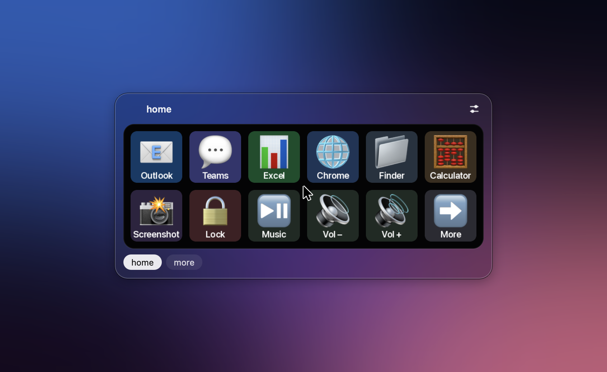
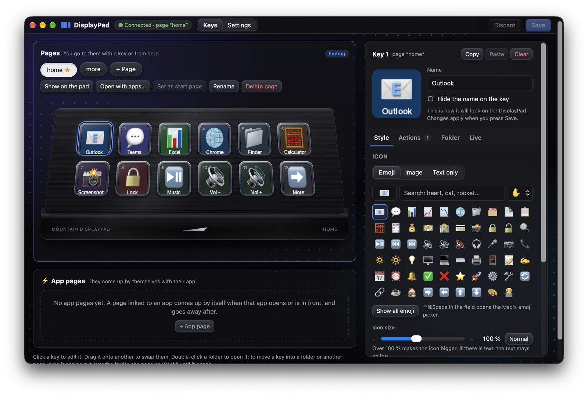

# DisplayPad for Mac

**Tus apps, atajos, macros y sonidos a un clic: en un Mountain DisplayPad, o flotando
justo donde está tu mouse.**

[Descargar](https://github.com/jgptrd/displaypad-mac/releases/latest) ·
[Guía completa](docs/GUIDE.es.md) · [English](README.md)



DisplayPad for Mac hace funcionar el **Mountain DisplayPad** (12 teclas, cada una con su
propia pantalla) en macOS, sin BaseCamp. Y pone esas mismas teclas en tu pantalla: el
**pad flotante**, a un atajo de distancia en cualquier app. ¿No tienes un DisplayPad? El
pad flotante funciona por su cuenta.

> **Hecho con IA:** escrito con [Claude Code](https://claude.com/claude-code), dirigido y
> probado por una persona en un DisplayPad real. Ver [Hecho con IA](#hecho-con-ia).

## El pad flotante

Pulsa **⌘ + clic central** en cualquier lugar. Tus teclas aparecen bajo el mouse. Haz clic
en una: hace su trabajo en la app que estabas usando, y el pad flotante se quita del medio.

- **Justo donde estás.** Sin ventanas que buscar, sin ícono en el Dock, sin cambiar de
  app. Se abre junto al mouse y se cierra solo.
- **Toda tu configuración.** Las mismas páginas, carpetas, imágenes y teclas en vivo que
  en el DisplayPad. Configura una tecla una vez y úsala en los dos.
- **Sin hardware.** Úsalo en la laptop fuera de casa, o sin ningún DisplayPad.
- **Tu atajo.** ⌘ + clic central, un botón lateral del mouse o cualquier combinación de
  teclas. Con el teclado, 1 a 9, 0, - e = pulsan las teclas 1 a 12, y Esc lo cierra.

Un clic hace lo que normalmente requiere varias apps:

| En lugar de… | Una tecla del pad flotante puede |
|---|---|
| Un lanzador de apps | Abrir apps, carpetas y archivos, o una web en el navegador que elijas, volviendo a su pestaña si ya está abierta |
| Una app de atajos o de textos | Pulsar cualquier atajo de teclado, o escribir un texto preparado, en la app donde estás trabajando |
| Un grabador de macros | Repetir teclas, clics, arrastres y desplazamientos: una vez, varias veces o mientras la mantienes |
| Un tablero de sonidos | Reproducir efectos de sonido y música, con una tecla que los detiene todos |
| Un control para transmitir | Salir en vivo, grabar, cambiar de escena y silenciar el micrófono en OBS Studio, aunque OBS esté en segundo plano |
| Una herramienta de automatización | Ejecutar comandos de terminal y AppleScript, cambiar el brillo de la pantalla, controlar la música y el volumen |

Una tecla también puede hacer varias de estas cosas seguidas.
[Todo sobre el pad flotante →](docs/GUIDE.es.md#el-pad-flotante)

## Funciones

- **Teclas con estilo:** emoji, imágenes, GIF animados y Lottie, fondos degradados y en
  movimiento, y un efecto al pulsar (onda, brillo, chispas…).
- **Páginas y carpetas:** todas las que quieras, carpetas dentro de carpetas, y páginas
  que aparecen solas con una app, con páginas listas para casi 30 apps populares
  (Photoshop, Premiere Pro, Excel, Zoom, Figma, OBS…).
- **Teclas en vivo:** la hora, el uso de CPU, GPU y memoria, la batería, lo que suena, si
  OBS está en vivo o la salida de un comando, como texto o como medidor.
- **Un configurador gráfico** en su propia ventana: arrastra teclas, suelta imágenes y
  sonidos sobre ellas, graba atajos y prueba las acciones antes de guardar. En inglés y
  español, claro y oscuro.
- **Asistentes de IA (MCP):** si lo permites, Claude u otra app de IA de tu Mac puede
  configurar teclas por ti (*«Agrega una página con mis apps de reuniones»*).
- **Siempre listo:** arranca al iniciar sesión, se reconecta después de dormir el Mac y
  aplica los cambios al instante.



## Instalación

Necesitas macOS (probado en macOS 27.2 con Apple Silicon), [Homebrew](https://brew.sh),
Python 3.11 o superior (`brew install python@3.14`) y las Command Line Tools de Xcode
(`xcode-select --install`).

1. Descarga el zip de la [última versión](https://github.com/jgptrd/displaypad-mac/releases/latest)
   y descomprímelo.
2. En Terminal, ejecuta:

   ```bash
   cd displaypad-mac
   ./install.sh
   ```

3. Cuando macOS lo pida, permite a **Python** en **Accesibilidad** (para los atajos, el
   texto y el atajo del mouse del pad flotante) y, si tienes un DisplayPad, en
   **Monitoreo de entrada**.

Cuando sale una versión nueva, el configurador la ofrece: pulsa **Actualizar ahora** y tu
configuración se conserva ([Actualizaciones](docs/GUIDE.es.md#actualizaciones)). Para
quitarlo, ejecuta `./uninstall.sh`. Más en
[Instalación en detalle](docs/GUIDE.es.md#instalación-en-detalle).

## Primeros pasos

1. Abre **DisplayPad** desde Aplicaciones. El configurador empieza en inglés: cámbialo a
   español en **Settings → Language**.
2. Haz clic en una tecla, elige cómo se ve y qué hace, y pulsa **Guardar**.
3. Pulsa **⌘ + clic central** en cualquier lugar y haz clic en tu nueva tecla.

## Más información

La [guía completa](docs/GUIDE.es.md) explica cada función y ajuste:

- [El pad flotante](docs/GUIDE.es.md#el-pad-flotante) y
  [el configurador](docs/GUIDE.es.md#el-configurador), con sus
  [ajustes](docs/GUIDE.es.md#ajustes)
- [Tablero de sonidos](docs/GUIDE.es.md#tablero-de-sonidos),
  [teclas en vivo](docs/GUIDE.es.md#teclas-en-vivo),
  [fondos y efectos al pulsar](docs/GUIDE.es.md#fondos-y-efectos-al-pulsar) y
  [animaciones](docs/GUIDE.es.md#animaciones-gif-y-lottie)
- [Asistentes de IA (MCP)](docs/GUIDE.es.md#asistentes-de-ia-mcp)
- [Editar la configuración a mano](docs/GUIDE.es.md#editar-la-configuración-a-mano),
  [comandos útiles](docs/GUIDE.es.md#comandos-útiles),
  [solución de problemas](docs/GUIDE.es.md#solución-de-problemas) y
  [cómo funciona](docs/GUIDE.es.md#cómo-funciona)

## Hecho con IA

Este proyecto se escribió con **Claude Code**, el asistente de programación con IA de
Anthropic: el driver, el servicio, el configurador, el servidor MCP, el instalador y la
documentación. Una persona dirigió el trabajo, decidió qué construir y probó cada función
en un DisplayPad real con macOS. Revisa el código como harías con cualquier proyecto de
código abierto antes de depender de él.

## Créditos

- Protocolo USB y secuencia de envío de imágenes:
  [oss-mountain-displaypad](https://github.com/AnnikenYT/oss-mountain-displaypad) de
  AnnikenToGo (MIT). Reimplementado en Python en `displaypad_mac/driver.py`.
- La forma de activar el pad se entendió primero gracias a
  [BaseCamp-Linux](https://github.com/ramisotti13-eng/BaseCamp-Linux) (solo consultado,
  sin copiar código).
- Animaciones Lottie: [rlottie](https://github.com/Samsung/rlottie) mediante
  [rlottie-python](https://github.com/laggykiller/rlottie-python) (LGPL 2.1).
- La parte de macOS (activación por IOKit, reclamo de IF1 con libusb, el servicio, las
  acciones, el brillo de las pantallas, el configurador y el servidor MCP) es nueva y se
  verificó en el hardware.

Detalles y textos de las licencias: [THIRD_PARTY_NOTICES.md](THIRD_PARTY_NOTICES.md).

## Licencia

[MIT](LICENSE). Sin relación con Mountain ni con 360 Service Agency GmbH, que no lo
respaldan ni le dan soporte. Mountain y DisplayPad son marcas de sus dueños.
