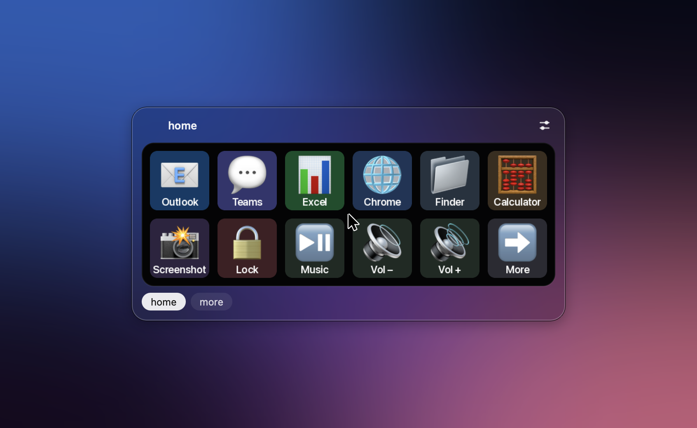
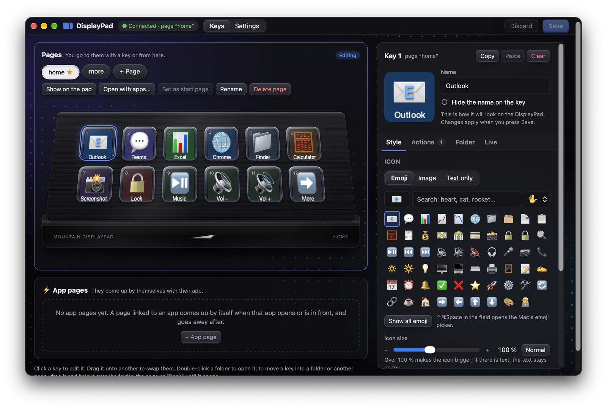

# DisplayPad for Mac

**Your apps, shortcuts, macros and sounds, one click away: on a Mountain DisplayPad, or
floating right where your mouse is.**

[Download](https://github.com/jgptrd/displaypad-mac/releases/latest) ·
[Full guide](docs/GUIDE.md) · [Español](README.es.md)



DisplayPad for Mac runs the **Mountain DisplayPad** (12 keys, each with its own screen)
on macOS, without BaseCamp. And it puts the same keys on your screen: the **floating
pad**, one shortcut away in any app. No DisplayPad? The floating pad works on its own.

> **Made with AI:** written with [Claude Code](https://claude.com/claude-code), directed
> and tested by a person on a real DisplayPad. See [Made with AI](#made-with-ai).

## The floating pad

Press **⌘ + middle click** anywhere. Your keys appear under the mouse. Click one: it does
its job in the app you were using, and the floating pad gets out of the way.

- **Right where you are.** No window to find, no Dock icon, no switching apps. It opens
  at the mouse and closes by itself.
- **Your whole setup.** The same pages, folders, pictures and live keys as the
  DisplayPad. Set up a key once and use it on both.
- **No hardware needed.** Use it on a laptop on the go, or without a DisplayPad at all.
- **Your shortcut.** ⌘ + middle click, a side mouse button or any key combination. On
  the keyboard, 1 to 9, 0, - and = press keys 1 to 12, and Esc closes it.

One click does what usually takes a handful of apps:

| Instead of a… | A key on the floating pad can |
|---|---|
| App launcher | Open apps, folders and files, or a website in the browser you choose, going back to its tab if it's already open |
| Shortcut or snippet tool | Press any keyboard shortcut, or type a ready-made text, in the app you're working in |
| Macro recorder | Replay keystrokes, clicks, drags and scrolling: once, several times or while held |
| Soundboard | Play sound effects and music, with a key that stops them all |
| Streaming controller | Go live, record, switch scenes and mute the mic in OBS Studio, even with OBS in the background |
| Automation tool | Run shell commands and AppleScript, change screen brightness, control music and volume |

A key can also do several of these in a row.
[All about the floating pad →](docs/GUIDE.md#the-floating-pad)

## Features

- **Keys that look the part:** emoji, pictures, animated GIFs and Lottie, gradient and
  moving backgrounds, and a press effect (ripple, glow, sparkle…).
- **Pages and folders:** as many as you like, folders inside folders, and pages that come
  up by themselves with an app, with ready-made pages for nearly 30 popular apps
  (Photoshop, Premiere Pro, Excel, Zoom, Figma, OBS…).
- **Live keys:** the time, CPU, GPU and memory use, the battery, what's playing, whether
  OBS is live, or a command's output, as text or as a meter.
- **A visual configurator** in its own window: drag keys around, drop pictures and sounds
  on them, record shortcuts and test actions before you save. English and Spanish, light
  and dark.
- **AI assistants (MCP):** if you allow it, Claude or another AI app on your Mac can set
  up keys for you (*"Add a page with my meeting apps"*).
- **Always ready:** starts at login, reconnects after sleep and picks up changes at once.



## Install

You need macOS (tested on macOS 27.2 with Apple Silicon), [Homebrew](https://brew.sh),
Python 3.11 or newer (`brew install python@3.14`) and the Xcode Command Line Tools
(`xcode-select --install`).

1. Download the zip from the [latest release](https://github.com/jgptrd/displaypad-mac/releases/latest)
   and unzip it.
2. In Terminal, run:

   ```bash
   cd displaypad-mac
   ./install.sh
   ```

3. When macOS asks, allow **Python** in **Accessibility** (for shortcuts, typed text and
   the floating pad's mouse shortcut) and, if you have a DisplayPad, in **Input
   Monitoring**.

To update, run `./install.sh` again: your setup is kept. To remove it, run
`./uninstall.sh`. More in [Install in detail](docs/GUIDE.md#install-in-detail).

## Get started

1. Open **DisplayPad** from Applications.
2. Click a key, choose how it looks and what it does, and press **Save**.
3. Press **⌘ + middle click** anywhere and click your new key.

## Learn more

The [full guide](docs/GUIDE.md) covers every feature and setting:

- [The floating pad](docs/GUIDE.md#the-floating-pad) and
  [the configurator](docs/GUIDE.md#the-configurator), with its
  [settings](docs/GUIDE.md#settings)
- [Soundboard](docs/GUIDE.md#soundboard), [live keys](docs/GUIDE.md#live-keys),
  [backgrounds and press effects](docs/GUIDE.md#backgrounds-and-press-effects) and
  [animations](docs/GUIDE.md#animations-gif-and-lottie)
- [AI assistants (MCP)](docs/GUIDE.md#ai-assistants-mcp)
- [Editing the configuration by hand](docs/GUIDE.md#editing-the-configuration-by-hand),
  [useful commands](docs/GUIDE.md#useful-commands),
  [troubleshooting](docs/GUIDE.md#troubleshooting) and
  [how it works](docs/GUIDE.md#how-it-works)

## Made with AI

This project was written with **Claude Code**, Anthropic's AI coding assistant: the
driver, the service, the configurator, the MCP server, the installer and the
documentation. A person directed the work, decided what to build and tested every feature
on a real DisplayPad on macOS. Review the code as you would any other open-source project
before you rely on it.

## Credits

- USB protocol and image upload sequence:
  [oss-mountain-displaypad](https://github.com/AnnikenYT/oss-mountain-displaypad) by
  AnnikenToGo (MIT). Reimplemented in Python in `displaypad_mac/driver.py`.
- How the pad is switched on was first understood from
  [BaseCamp-Linux](https://github.com/ramisotti13-eng/BaseCamp-Linux) (consulted only,
  no code copied).
- Lottie animations: [rlottie](https://github.com/Samsung/rlottie) through
  [rlottie-python](https://github.com/laggykiller/rlottie-python) (LGPL 2.1).
- The macOS part (IOKit activation, claiming IF1 with libusb, the service, actions,
  screen brightness, configurator and MCP server) is new and was verified on the hardware.

Details and license texts: [THIRD_PARTY_NOTICES.md](THIRD_PARTY_NOTICES.md).

## License

[MIT](LICENSE). Not affiliated with, endorsed by or supported by Mountain or 360 Service
Agency GmbH. Mountain and DisplayPad are trademarks of their owners.
